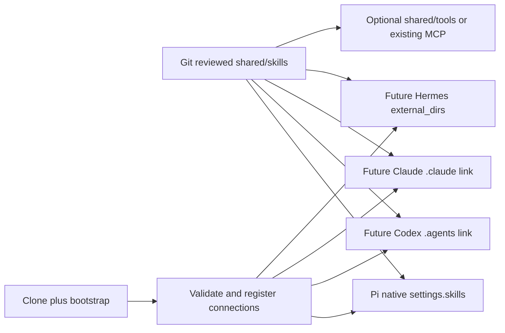

# P2 Shared Skills Architecture

Status: **PROPOSED — P2.1 design review only**. Investigated 2026-10-12.
Architecture/director: GPT. Investigation and Git documentation: Codex. Independent verification: Claude. Final direction approval: user.
Repository: `hbombheart1230-dotcom/agentco`. Design branch: `feature/p2-shared-skills-design`.
Verified main/design base: `2eb1bd7f476d70951e4364040592c065f97c1a17`.

Creating this document does **not** authorize P2.2 implementation. GPT/user must approve the design, initial skill and implementation scope first.

## 1. Goal and non-goals

Establish one editable, Git-managed source for Agentco-owned portable skills in `shared/skills/`, with native harness discovery and minimal connection metadata. Restore that arrangement through clone plus bootstrap on Windows first, then other PCs/drives and Linux/cloud.

P2.1 changes documentation only. No skill installation, copying, relocation, deletion, Pi settings changes, bootstrap/doctor code changes, harness installation, runtime changes or P2.2 implementation. No upstream Pi patches, new skill loader, marketplace, general synchronization daemon or future placeholder folders.

## 2. Observed current state

Git fetch confirmed main and origin/main at the stated base, with a clean working tree and no existing local/remote design branch. The design branch was created in the canonical workspace without another worktree.

- Installed upstream Pi: **1.0.4**, exact-pinned. The launcher derives `PI_CODING_AGENT_DIR=<repo>/pi-dev` from the script location.
- `pi-dev/settings.json` has no explicit `skills` array. Configured packages are `npm:@ian-pascoe/pi-lsp@0.8.0` and `npm:@tmustier/pi-skill-creator@0.3.4`.
- Five configured extension entries: official subagent/plan examples under the installed Pi package and three existing Agentco extensions. Native codemode/MCP discovery remains separate from skills. Preserve all of these.
- No `pi-dev/skills/`, `.pi/skills/`, `.pi/settings.json`, repo `.agents/skills/`, or `shared/skills/` exists. The user-level `.agents/skills/` location was also absent; no other home folders were scanned.
- No project-managed Claude/Codex/Hermes skill adapter is configured. This does not assert that those applications are absent elsewhere on the machine. Their implementation versions have not been selected or tested for this project.

Read-only discovery used installed Pi's public `loadSkills` helper, existing package manifests and current default locations. It did not start an agent, install packages, write runtime or inspect credentials. It returned two skills with zero diagnostics:

| Discovered skill | Installed source / location | Loading policy | Ownership |
|---|---|---|---|
| `skill-creator` | `@tmustier/pi-skill-creator@0.3.4`; `pi-dev/npm/node_modules/@tmustier/pi-skill-creator/SKILL.md` | Model selection allowed; explicit command available | Community/package-managed |
| `pi-lsp` | `@ian-pascoe/pi-lsp@0.8.0`; `pi-dev/npm/node_modules/@ian-pascoe/pi-lsp/skills/pi-lsp/SKILL.md` | `disable-model-invocation: true`; explicit-only | Community/Pi-specific |

These are available discovered skills, not a claim about past invocation history. Neither is copied or promoted into shared ownership. The community creator remains the existing package; LSP configuration guidance stays with its Pi package.

## 3. Evidence and compatibility

**CONFIRMED** means demonstrated in the installed pinned implementation or explicitly documented by an official source. It is not a Windows end-to-end certification for an uninstalled future harness. **UNKNOWN** means not established by this investigation. **NOT SUPPORTED** is scoped to the particular documented/inspected mechanism, not a blanket statement about a product.

### Sources and version boundaries

| ID | Official source | Evidence boundary |
|---|---|---|
| P1 | [Pi v1.0.4 skills](https://raw.githubusercontent.com/earendil-works/pi/v1.0.4/packages/coding-agent/docs/skills.md) | Agent Skills format and loading |
| P2 | [Pi v1.0.4 settings](https://raw.githubusercontent.com/earendil-works/pi/v1.0.4/packages/coding-agent/docs/settings.md) | Explicit resource paths |
| P3 | [Pi v1.0.4 loader source](https://github.com/earendil-works/pi/blob/v1.0.4/packages/coding-agent/src/core/skills.ts) and [package manager](https://github.com/earendil-works/pi/blob/v1.0.4/packages/coding-agent/src/core/package-manager.ts) | Also inspected corresponding installed `dist/core/skills.js`, `package-manager.js`, `resource-loader.js`; pinned package is authoritative locally |
| C1 | [Claude Code skills](https://code.claude.com/docs/en/skills) | Rolling official docs read 2026-10-12; exact target/minimum CLI version for these discovery features UNKNOWN |
| C2 | [Claude plugin manifest](https://code.claude.com/docs/en/plugins-reference) | Native plugin directory references and containment rules; not tested locally |
| O1 | [OpenAI local skills](https://learn.chatgpt.com/docs/build-skills#where-codex-loads-local-skills) | Official Codex skills URL redirects here; rolling docs read 2026-10-12, not an API-shell skill registration contract; exact project CLI version/minimum UNKNOWN |
| H1 | [Hermes skills](https://hermes-agent.nousresearch.com/docs/user-guide/features/skills) | Rolling official docs read 2026-10-12; exact target/minimum Hermes release UNKNOWN |
| S1 | [Agent Skills specification](https://agentskills.io/specification) | Portable format; does not guarantee identical invocation/tool semantics |
| W1 | [Microsoft mklink](https://learn.microsoft.com/en-us/windows-server/administration/windows-commands/mklink) | Windows directory symlink/junction mechanisms, not harness support |
| G1 | [Git core.symlinks](https://git-scm.com/docs/git-config#Documentation/git-config.txt-coresymlinks) | Link checkout limitations, not runtime loader support |

### Support matrix

| Capability | Pi 1.0.4 | Claude Code | Codex CLI | Hermes |
|---|---|---|---|---|
| Directory containing `SKILL.md`, metadata then on-demand body | CONFIRMED P1/P3 | CONFIRMED C1 | CONFIRMED O1 | CONFIRMED H1 |
| Native discovery roots | CONFIRMED: agent-dir skills, `.pi/skills`, user/repo `.agents/skills`, package-declared skills P1/P3 | CONFIRMED: personal/project `.claude/skills`, plugin skills C1 | CONFIRMED: user/repo `.agents/skills`, repo ancestor scan O1 | CONFIRMED: profile skills, trusted project `.hermes/skills` / `.agents/skills` H1 |
| Direct arbitrary directory reference | CONFIRMED: `settings.skills` P2/P3 | CONFIRMED via plugin manifest `skills` C2; arbitrary non-plugin setting UNKNOWN | UNKNOWN: no arbitrary scan-root setting established; `skills.config.path` alone is not proven registration O1 | CONFIRMED: `skills.external_dirs` H1 |
| Symlinked skill folder | CONFIRMED installed loader P3 | CONFIRMED non-plugin skill folders C1 | CONFIRMED O1 | CONFIRMED documented symlink-view handling H1; chosen Windows behavior UNKNOWN |
| Windows junction adapter E2E | UNKNOWN | UNKNOWN | UNKNOWN | UNKNOWN |
| Bare `shared/skills` automatically discovered without a connection | NOT SUPPORTED by inspected default discovery P3 | UNKNOWN, not in documented native roots | UNKNOWN, not in documented native roots | UNKNOWN, not in documented native roots |
| Same extended YAML, tool IDs, invocation syntax, permissions everywhere | UNKNOWN; do not assume | UNKNOWN; do not assume | UNKNOWN; do not assume | UNKNOWN; do not assume |

Native link discovery and Windows junction support are different claims. Pi follows directory links and deduplicates real file paths; different skills with the same name keep the first and warn. Codex can expose duplicate names separately. Hermes can modify writable external skills in place. Agentco must therefore detect collisions and preserve ownership rather than assume one common precedence or a read-only mount. Sources: P3, O1, H1.

Claude's native plugin path must stay inside the plugin root (C2). A plugin in a sibling harness directory cannot simply declare `../shared/skills`: **NOT SUPPORTED** by those containment rules. A plugin rooted at shared could reference `./skills`, but packaging, naming and other component scans need separate review. This is a supported alternative, not an implemented adapter.

## 4. Ownership and portability contract

1. `shared/skills/` is the single authoring source for approved **Agentco-owned portable** skills. Harness views must not become separate editable copies.
2. User-installed, system and community-package skills keep their existing ownership/location. Inventorying a skill is not permission to relocate, delete or vendor it. Any later promotion needs owner approval, license/provenance review and a specific migration plan.
3. Existing extensions/hooks/plugins stay with their harness. Shared reusable execution belongs in `shared/tools/` or a justified existing MCP/CLI interface. Prefer instruction-only skills initially; do not introduce a tool framework just to share instructions.
4. Use one directory per skill, matching a globally distinctive name such as `agentco-<workflow>`. The portable authoring subset is `name`, `description`, optional `license`, `compatibility`, `metadata`, plus Markdown and relative bundled references. Do not depend on `allowed-tools` as a cross-harness security policy or assume extended fields execute identically. Source: S1.
5. Keep tool/provider-specific commands and metadata out of the shared procedure unless their declared compatibility is intentionally narrow. Pi codemode, Claude dynamic shell injection and Codex UI metadata are not universal execution interfaces.
6. Relative bundled references stay inside the skill. Do not locate `shared/tools` by climbing `../..` from a visible link path: its parent may be a harness discovery directory. Resolve the repository root explicitly through the existing launcher/Git context or a future root-derived environment value; never store a machine path in tracked connection metadata.
7. Shared assets contain no credentials, sessions or generated outputs. Runtime evidence belongs under ignored `results/`. Review skill changes as executable instructions. Symlinks and external directories are discovery conveniences, not write-protection boundaries.

## 5. Alternatives

| Criterion | A: native direct references | B: symlink/junction views | C: bootstrap registration/synchronization |
|---|---|---|---|
| Official support | Pi and Hermes confirmed; Claude plugin variant confirmed; Codex arbitrary roots unknown | Symlink discovery documented/inspected; junction E2E unknown | Registration can compose native features. General custom copy-sync is not a confirmed native common feature |
| Maintenance / duplication | One live source, little metadata | One live source plus link ownership records | Registration stays small; materialized copies add drift/hash/version bookkeeping |
| Windows | Direct paths avoid link privileges; validate each future runtime | Directory symlink capability must be checked; junction only after actual loader tests | Can recreate machine-local references; copy fallback would need a separately approved contract |
| Portability | Relative Pi paths; future Hermes root-derived variable | Relative symlinks portable when supported; recreate local junction targets after relocation | Clone + idempotent registration fits bootstrap; machine state must be regenerated |
| Failure / collision | Wrong path, missing asset, trust or shadowing | Broken/wrong link, cycles, owner collision, writes through target | Partial registration, unexpected overwrite, stale deployments |
| Bootstrap complexity | Low for Pi; future profile registration required | Moderate: preflight, ownership, conflict refusal, safe unlink | Low for registration; high for reliable bidirectional sync |

Git can check symlinks out as plain text when `core.symlinks=false` (G1). Windows distinguishes directory symbolic links and junctions (W1). Do not commit a machine-bound junction or assume a fresh Windows clone materializes link entries correctly. The Windows privilege/capability choice remains a P3 acceptance gate; no elevation or link creation happens in P2.1.

### Recommended proposal

Use **A first, B where needed, with C limited to idempotent registration**:

- P2.2: connect only the existing Pi through its native relative path setting. No additional harness or link is needed for the first implementation.
- Future Hermes: prefer its native external directory setting; keep newly created personal skills profile-local and gate any write-capable shared access.
- Future Codex: native per-skill directory symlink views under repo `.agents/skills/` are the proposed bridge.
- Future Claude: prefer the small documented per-skill `.claude/skills/` symlink bridge for local authoring. Evaluate the native plugin A variant if link creation is unavailable or distribution is later required; do not assume an arbitrary sibling plugin reference works.
- Bootstrap restores approved connections, not skill bodies. Do not silently fall back to copied skills when links fail. Block the affected future adapter or obtain approval for a native alternative. No bidirectional copy synchronization.

This selection is a maintenance recommendation from the evidence, not a FINAL architecture decision.

## 6. Proposed folder structure and data flow

Everything below is a future design, not a claim that the paths currently exist. Create directories only when an approved asset/adapter actually needs them.

```text
<repo>/
  shared/
    skills/<approved-agentco-skill>/
      SKILL.md
      references/                    # optional, only with actual files
    tools/                           # only when reusable execution is justified
  pi-dev/settings.json               # existing; later add relative skills reference
  .agents/skills/<approved-name>      # P3 generated Codex link, not another source
  .claude/skills/<approved-name>      # P3 generated Claude link, not another source
  scripts/                           # existing bootstrap; later registration only if needed
  results/                           # ignored verification/adapter ownership state
```



The arrows are read/discovery relationships, not permission to publish or mutate shared source. A link exposes an existing skill directory; no independent SKILL.md is maintained in a harness directory. No `hermes-dev/`, `codex-cli-dev/`, `claude-code-dev/`, Harbor or Commander placeholders are created for this diagram.

## 7. Harness connection contracts

| Harness / phase | Proposed connection | Constraints and validation |
|---|---|---|
| Pi / P2.2 | Append `"skills": ["../shared/skills"]` to existing agent settings, preserving other entries | Resolves from pi-dev (P2). Keep package declarations, default model/tools, extension list and hideThinkingBlock unchanged. Preserve personal/default/package discovery; detect duplicate names through Pi diagnostics |
| Codex / P3 | Each approved `.agents/skills/<name>` link targets `../../shared/skills/<name>` | Native symlink support O1; no user/global skill edits. Validate root and subdirectory sessions against the pinned actual CLI. Junction is a separate unconfirmed fallback |
| Claude / P3 | Each approved `.claude/skills/<name>` link targets `../../shared/skills/<name>` | Native non-plugin symlink support C1. No edits to personal skills. Confirm invocation and bundled references; review plugin alternative separately if needed |
| Hermes / P3 | Profile-local `skills.external_dirs` entry `${AGENTCO_ROOT}/shared/skills` | H1 establishes variable substitution. A future launcher computes AGENTCO_ROOT; no tracked absolute path. Preserve profile settings and creation directory; verify version/trust/write behavior before enabling |

For future bridges, reserve only `agentco-*` link names that the approved catalog owns. Do not replace an existing directory, file, symlink or junction just because its name matches. Preflight must show what would change; an existing correct owned link is a no-op, a conflict is a clear failure. Track adapter ownership locally so rollback cannot touch user-created links. Prefer per-skill links over replacing an entire personal/discovery directory.

For Hermes, external_dirs does not guarantee read-only consumption. Before P3 activation choose and test a native permission/profile mechanism or an appropriate filesystem boundary for consumer writes. Repository policy and Git review alone do not enforce that boundary. Do not redirect autonomous skill creation into shared source by default.

## 8. Implementation stages and approval gates

1. **P2.1 now:** finish this evidence-backed proposal, a PROPOSED ADR and review entrypoint. Commit/push the documentation branch only. GPT/user choose the initial instruction-only workflow and confirm the per-harness strategy.
2. **P2.2 after explicit approval:** add one approved real shared skill (or an explicitly approved harmless validation fixture), with portable frontmatter and bundled references only as needed. Add Pi's native relative connection. Do not move current user/community skills.
3. Reuse installed Pi's loader/diagnostics to validate format, discovery, name collisions and original package skills. Add only the minimum verification needed; do not write a second loader.
4. Verify clone/bootstrap behavior. Because both asset and Pi reference are tracked, existing bootstrap may already suffice; change it only if an approved requirement proves a gap. Add a doctor check only if needed to report the approved discovery contract, preserving its read-only behavior.
5. **P2.3:** Claude independently reviews the exact implementation SHA and reruns Pi acceptance checks. GPT/user resolve findings before merge or expansion.
6. **P3 or later authorized task:** select/pin actual Claude/Codex/Hermes versions, validate documentation against those versions and test each adapter. Only then create its real configuration or directories. Reopen this proposal if the native contract differs.

### Explicit P2.2 Codex implementation boundary

Allowed only after approval: the selected shared asset, Pi `skills` path addition, minimal validation/tests/docs, and narrowly justified bootstrap/doctor adjustments. Initially keep existing npm packages, extensions, runtime and user-installed skills unchanged. No Claude/Codex/Hermes installation or adapter activation, community skill migration, reusable execution platform, Harbor/Commander work, broad source refactor or uncontrolled user-profile registration.

## 9. Acceptance criteria

### P2.1 design deliverable

- Only intended Markdown documentation changes; clean diff and valid local links.
- Baseline and actual discovered skill paths recorded without secrets or fabricated files.
- Capabilities have explicit evidence/status/version boundaries; unknown does not become confirmed through recommendation.
- All three alternatives, ownership, Windows limitations, implementation gates and rollback are reviewable.
- Proposed architecture remains unapproved; CURRENT_TASK points to design review, not automatic implementation.

### P2.2 implementation, after approval

- The approved asset has exactly one Git-managed authoring location under shared/skills; no copied harness bodies.
- Pi discovers/invokes it and reads a bundled reference from canonical and nested working directories. Loader diagnostics contain no unexpected invalid skills or collisions.
- Both existing package skills remain available with their existing invocation policy; all unrelated settings and extensions are preserved.
- New clone in a path containing spaces restores the pinned baseline through bootstrap without copied node_modules/runtime, requiring no link privilege for Pi's A path. Existing .env is never overwritten or printed.
- Doctor passes; existing 14/14 smoke and relevant harness discovery regressions remain PASS. Verification outputs are ignored under results; no credential/session/runtime files are committed.
- Rollback removes only the new owned connection and leaves current packages, personal skills and shared source recoverable.

### P2.3 and future multi-harness validation

Claude reviews source ownership and evidence independently; report failures/UNKNOWN rather than extrapolate from common SKILL.md format. On each later installed/pinned harness test discovery from root/subdirectories, explicit invocation, reference resolution, duplicate-name conflicts, a missing target and a relocation. Windows link/junction tests must not modify personal skills or follow targets during unlink. Cloud/Linux fresh-clone checks regenerate local connections. Missing/uninstalled harnesses are explicitly NOT RUN, not PASS.

## 10. Rollback plan

P2.1: revert only this documentation commit if the proposal is rejected; preserve earlier decisions and all local state. P2.2: revert only the new Pi skill reference/approved implementation changes. Preserve new shared files for review or revert them through Git as specifically agreed; no broad cleanup.

Future adapters: unlink only an owned entry after checking its type and exact target; never recursively delete the target. Remove only the owned Hermes external_dirs entry, preserving other profile entries. Native plugin deployments use their normal disable/registration rollback. Do not remove user skills, packages, runtime, credentials or results. Run the affected discovery check and report what remains after rollback.

## 11. Risks and decisions still needed

- GPT/user approval, initial workflow and whether its first validation asset is a fixture or real procedure.
- Exact future CLI versions and minimum versions for required discovery features; rolling documentation is not a pinned implementation guarantee.
- Native Windows symlink capability, junction loader behavior and relocation semantics. No silent copy fallback.
- Hermes write access to shared assets and the appropriate consumer permission/profile boundary.
- Claude link versus native plugin packaging if the Windows link route is unavailable; namespace and plugin-root side effects need testing.
- Different frontmatter extensions, trust/precedence and tool surfaces; common Markdown does not make runtime behavior interchangeable.
- License/provenance for any later third-party promotion and avoiding collisions with user/system/package skills.

These unresolved design/implementation gates belong in this work order. Unrelated existing follow-ups remain in TASK_INBOX. No skill migration or P2.2 authorization is implied by this proposal.
