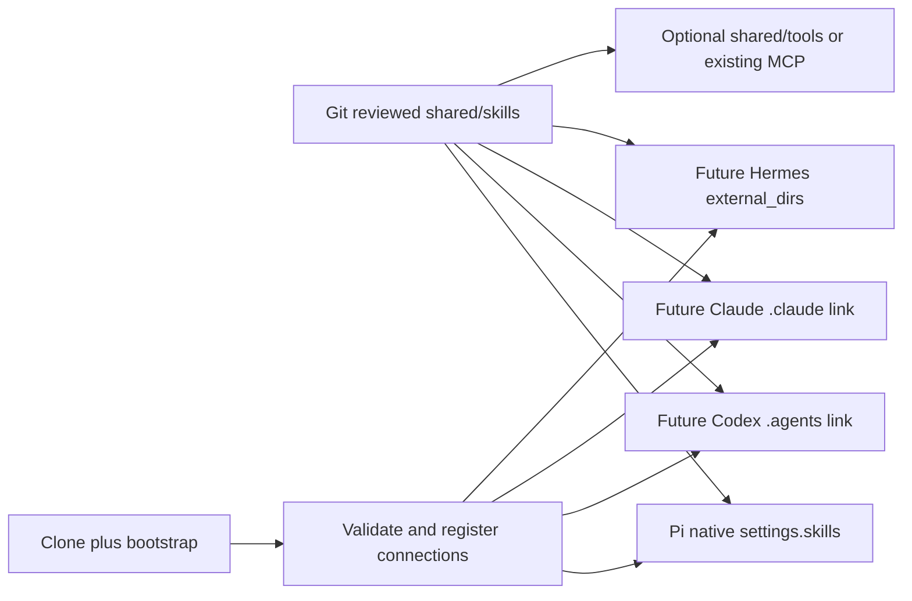

# P2 Shared Skills Architecture

Status: **P2.1 architecture APPROVED / P2.2 implementation APPROVED (2026-10-12)**. P2.1 investigation dated 2026-10-12; joint Claude verification follows P2.2 implementation.
Architecture/director: GPT. Investigation and Git documentation: Codex. Independent verification: Claude. Final direction approval: user.
Repository: `hbombheart1230-dotcom/agentco`. Design branch: `feature/p2-shared-skills-design`.
Verified main/design base: `2eb1bd7f476d70951e4364040592c065f97c1a17`.

Creating the original P2.1 document alone did not authorize implementation. GPT/user approval of the limited first skill and P2.2 scope was granted 2026-10-12; execute only the approved order below.

## 1. Goal and non-goals

Establish one editable, Git-managed source for Agentco-owned portable skills in `shared/skills/`, with native harness discovery and minimal connection metadata. Restore that arrangement through clone plus bootstrap on Windows first, then other PCs/drives and Linux/cloud.

P2.1 changes documentation only. No skill installation, copying, relocation, deletion, Pi settings changes, bootstrap/doctor code changes, harness installation, runtime changes or P2.2 implementation. No upstream Pi patches, new skill loader, marketplace, general synchronization daemon or future placeholder folders.

## 2. P2.1 pre-implementation observations

Git fetch confirmed main and origin/main at the stated base, with a clean working tree and no existing local/remote design branch. The design branch was created in the canonical workspace without another worktree.

- Installed upstream Pi: **1.0.4**, exact-pinned. The launcher derives `PI_CODING_AGENT_DIR=<repo>/pi-dev` from the script location.
- `pi-dev/settings.json` has no explicit `skills` array. Configured packages are `npm:@ian-pascoe/pi-lsp@0.8.0` and `npm:@tmustier/pi-skill-creator@0.3.4`.
- Five configured extension entries: official subagent/plan examples under the installed Pi package and three existing Agentco extensions. Native codemode/MCP discovery remains separate from skills. Preserve all of these.
- No `pi-dev/skills/`, `.pi/skills/`, `.pi/settings.json`, repo `.agents/skills/`, or `shared/skills/` exists. The user-level `.agents/skills/` location was also absent; no other home folders were scanned.
- No project-managed Claude/Codex/Hermes skill adapter is configured. This does not assert that those applications are absent elsewhere on the machine. Their implementation versions have not been selected or tested for this project.

Read-only discovery used installed Pi's public `loadSkills` helper, existing package manifests and current default locations. It did not start an agent, install packages, write runtime or inspect credentials. It returned two skills with zero diagnostics:

| Discovered skill | Installed source / location | Loading policy | Ownership |
|---|---|---|---|
| `skill-creator` | `@tmustier/pi-skill-creator@0.3.4`; `pi-dev/npm/node_modules/@tmustier/pi-skill-creator/SKILL.md` | Model selection allowed; explicit command available | Community/package-managed |
| `pi-lsp` | `@ian-pascoe/pi-lsp@0.8.0`; `pi-dev/npm/node_modules/@ian-pascoe/pi-lsp/skills/pi-lsp/SKILL.md` | `disable-model-invocation: true`; explicit-only | Community/Pi-specific |

These are available discovered skills, not a claim about past invocation history. Neither is copied or promoted into shared ownership. The community creator remains the existing package; LSP configuration guidance stays with its Pi package.

## 3. Evidence and compatibility

**CONFIRMED** means demonstrated in the installed pinned implementation or explicitly documented by an official source. It is not a Windows end-to-end certification for an uninstalled future harness. **UNKNOWN** means not established by this investigation. **NOT SUPPORTED** is scoped to the particular documented/inspected mechanism, not a blanket statement about a product.

### Sources and version boundaries

| ID | Official source | Evidence boundary |
|---|---|---|
| P1 | [Pi v1.0.4 skills](https://raw.githubusercontent.com/earendil-works/pi/v1.0.4/packages/coding-agent/docs/skills.md) | Agent Skills format and loading |
| P2 | [Pi v1.0.4 settings](https://raw.githubusercontent.com/earendil-works/pi/v1.0.4/packages/coding-agent/docs/settings.md) | Explicit resource paths |
| P3 | [Pi v1.0.4 loader source](https://github.com/earendil-works/pi/blob/v1.0.4/packages/coding-agent/src/core/skills.ts) and [package manager](https://github.com/earendil-works/pi/blob/v1.0.4/packages/coding-agent/src/core/package-manager.ts) | Also inspected corresponding installed `dist/core/skills.js`, `package-manager.js`, `resource-loader.js`; pinned package is authoritative locally |
| C1 | [Claude Code skills](https://code.claude.com/docs/en/skills) | Rolling official docs read 2026-10-12; exact target/minimum CLI version for these discovery features UNKNOWN |
| C2 | [Claude plugin manifest](https://code.claude.com/docs/en/plugins-reference) | Native plugin directory references and containment rules; not tested locally |
| O1 | [OpenAI local skills](https://learn.chatgpt.com/docs/build-skills#where-codex-loads-local-skills) | Official Codex skills URL redirects here; rolling docs read 2026-10-12, not an API-shell skill registration contract; exact project CLI version/minimum UNKNOWN |
| H1 | [Hermes skills](https://hermes-agent.nousresearch.com/docs/user-guide/features/skills) | Rolling official docs read 2026-10-12; exact target/minimum Hermes release UNKNOWN |
| S1 | [Agent Skills specification](https://agentskills.io/specification) | Portable format; does not guarantee identical invocation/tool semantics |
| W1 | [Microsoft mklink](https://learn.microsoft.com/en-us/windows-server/administration/windows-commands/mklink) | Windows directory symlink/junction mechanisms, not harness support |
| G1 | [Git core.symlinks](https://git-scm.com/docs/git-config#Documentation/git-config.txt-coresymlinks) | Link checkout limitations, not runtime loader support |

### Support matrix

| Capability | Pi 1.0.4 | Claude Code | Codex CLI | Hermes |
|---|---|---|---|---|
| Directory containing `SKILL.md`, metadata then on-demand body | CONFIRMED P1/P3 | CONFIRMED C1 | CONFIRMED O1 | CONFIRMED H1 |
| Native discovery roots | CONFIRMED: agent-dir skills, `.pi/skills`, user/repo `.agents/skills`, package-declared skills P1/P3 | CONFIRMED: personal/project `.claude/skills`, plugin skills C1 | CONFIRMED: user/repo `.agents/skills`, repo ancestor scan O1 | CONFIRMED: profile skills, trusted project `.hermes/skills` / `.agents/skills` H1 |
| Direct arbitrary directory reference | CONFIRMED: `settings.skills` P2/P3 | CONFIRMED via plugin manifest `skills` C2; arbitrary non-plugin setting UNKNOWN | UNKNOWN: no arbitrary scan-root setting established; `skills.config.path` alone is not proven registration O1 | CONFIRMED: `skills.external_dirs` H1 |
| Symlinked skill folder | CONFIRMED installed loader P3 | CONFIRMED non-plugin skill folders C1 | CONFIRMED O1 | CONFIRMED documented symlink-view handling H1; chosen Windows behavior UNKNOWN |
| Windows junction adapter E2E | UNKNOWN | UNKNOWN | UNKNOWN | UNKNOWN |
| Bare `shared/skills` automatically discovered without a connection | NOT SUPPORTED by inspected default discovery P3 | UNKNOWN, not in documented native roots | UNKNOWN, not in documented native roots | UNKNOWN, not in documented native roots |
| Same extended YAML, tool IDs, invocation syntax, permissions everywhere | UNKNOWN; do not assume | UNKNOWN; do not assume | UNKNOWN; do not assume | UNKNOWN; do not assume |

Native link discovery and Windows junction support are different claims. Pi follows directory links and deduplicates real file paths; different skills with the same name keep the first and warn. Codex can expose duplicate names separately. Hermes can modify writable external skills in place. Agentco must therefore detect collisions and preserve ownership rather than assume one common precedence or a read-only mount. Sources: P3, O1, H1.

Claude's native plugin path must stay inside the plugin root (C2). A plugin in a sibling harness directory cannot simply declare `../shared/skills`: **NOT SUPPORTED** by those containment rules. A plugin rooted at shared could reference `./skills`, but packaging, naming and other component scans need separate review. This is a supported alternative, not an implemented adapter.

## 4. Ownership and portability contract

1. `shared/skills/` is the single authoring source for approved **Agentco-owned portable** skills. Harness views must not become separate editable copies.
2. User-installed, system and community-package skills keep their existing ownership/location. Inventorying a skill is not permission to relocate, delete or vendor it. Any later promotion needs owner approval, license/provenance review and a specific migration plan.
3. Existing extensions/hooks/plugins stay with their harness. Shared reusable execution belongs in `shared/tools/` or a justified existing MCP/CLI interface. Prefer instruction-only skills initially; do not introduce a tool framework just to share instructions.
4. Use one directory per skill, matching a globally distinctive name such as `agentco-<workflow>`. The portable authoring subset is `name`, `description`, optional `license`, `compatibility`, `metadata`, plus Markdown and relative bundled references. Do not depend on `allowed-tools` as a cross-harness security policy or assume extended fields execute identically. Source: S1.
5. Keep tool/provider-specific commands and metadata out of the shared procedure unless their declared compatibility is intentionally narrow. Pi codemode, Claude dynamic shell injection and Codex UI metadata are not universal execution interfaces.
6. Relative bundled references stay inside the skill. Do not locate `shared/tools` by climbing `../..` from a visible link path: its parent may be a harness discovery directory. Resolve the repository root explicitly through the existing launcher/Git context or a future root-derived environment value; never store a machine path in tracked connection metadata.
7. Shared assets contain no credentials, sessions or generated outputs. Runtime evidence belongs under ignored `results/`. Review skill changes as executable instructions. Symlinks and external directories are discovery conveniences, not write-protection boundaries.

## 5. Alternatives

| Criterion | A: native direct references | B: symlink/junction views | C: bootstrap registration/synchronization |
|---|---|---|---|
| Official support | Pi and Hermes confirmed; Claude plugin variant confirmed; Codex arbitrary roots unknown | Symlink discovery documented/inspected; junction E2E unknown | Registration can compose native features. General custom copy-sync is not a confirmed native common feature |
| Maintenance / duplication | One live source, little metadata | One live source plus link ownership records | Registration stays small; materialized copies add drift/hash/version bookkeeping |
| Windows | Direct paths avoid link privileges; validate each future runtime | Directory symlink capability must be checked; junction only after actual loader tests | Can recreate machine-local references; copy fallback would need a separately approved contract |
| Portability | Relative Pi paths; future Hermes root-derived variable | Relative symlinks portable when supported; recreate local junction targets after relocation | Clone + idempotent registration fits bootstrap; machine state must be regenerated |
| Failure / collision | Wrong path, missing asset, trust or shadowing | Broken/wrong link, cycles, owner collision, writes through target | Partial registration, unexpected overwrite, stale deployments |
| Bootstrap complexity | Low for Pi; future profile registration required | Moderate: preflight, ownership, conflict refusal, safe unlink | Low for registration; high for reliable bidirectional sync |

Git can check symlinks out as plain text when `core.symlinks=false` (G1). Windows distinguishes directory symbolic links and junctions (W1). Do not commit a machine-bound junction or assume a fresh Windows clone materializes link entries correctly. The Windows privilege/capability choice remains a P3 acceptance gate; no elevation or link creation happens in P2.1.

### Recommended proposal

Use **A first, B where needed, with C limited to idempotent registration**:

- P2.2: connect only the existing Pi through its native relative path setting. No additional harness or link is needed for the first implementation.
- Future Hermes: prefer its native external directory setting; keep newly created personal skills profile-local and gate any write-capable shared access.
- Future Codex: native per-skill directory symlink views under repo `.agents/skills/` are the proposed bridge.
- Future Claude: prefer the small documented per-skill `.claude/skills/` symlink bridge for local authoring. Evaluate the native plugin A variant if link creation is unavailable or distribution is later required; do not assume an arbitrary sibling plugin reference works.
- Bootstrap restores approved connections, not skill bodies. Do not silently fall back to copied skills when links fail. Block the affected future adapter or obtain approval for a native alternative. No bidirectional copy synchronization.

This native-first/single-source direction is approved by D-009. Future version-specific Windows links, permissions and non-Pi adapters remain unverified and require separate P3 approval.

## 6. Proposed folder structure and data flow

Everything below is a future design, not a claim that the paths currently exist. Create directories only when an approved asset/adapter actually needs them.

```text
<repo>/
  shared/
    skills/<approved-agentco-skill>/
      SKILL.md
      references/                    # optional, only with actual files
    tools/                           # only when reusable execution is justified
  pi-dev/settings.json               # existing; later add relative skills reference
  .agents/skills/<approved-name>      # P3 generated Codex link, not another source
  .claude/skills/<approved-name>      # P3 generated Claude link, not another source
  scripts/                           # existing bootstrap; later registration only if needed
  results/                           # ignored verification/adapter ownership state
```



The arrows are read/discovery relationships, not permission to publish or mutate shared source. A link exposes an existing skill directory; no independent SKILL.md is maintained in a harness directory. No `hermes-dev/`, `codex-cli-dev/`, `claude-code-dev/`, Harbor or Commander placeholders are created for this diagram.

## 7. Harness connection contracts

| Harness / phase | Proposed connection | Constraints and validation |
|---|---|---|
| Pi / P2.2 | Append `"skills": ["../shared/skills"]` to existing agent settings, preserving other entries | Resolves from pi-dev (P2). Keep package declarations, default model/tools, extension list and hideThinkingBlock unchanged. Preserve personal/default/package discovery; detect duplicate names through Pi diagnostics |
| Codex / P3 | Each approved `.agents/skills/<name>` link targets `../../shared/skills/<name>` | Native symlink support O1; no user/global skill edits. Validate root and subdirectory sessions against the pinned actual CLI. Junction is a separate unconfirmed fallback |
| Claude / P3 | Each approved `.claude/skills/<name>` link targets `../../shared/skills/<name>` | Native non-plugin symlink support C1. No edits to personal skills. Confirm invocation and bundled references; review plugin alternative separately if needed |
| Hermes / P3 | Profile-local `skills.external_dirs` entry `${AGENTCO_ROOT}/shared/skills` | H1 establishes variable substitution. A future launcher computes AGENTCO_ROOT; no tracked absolute path. Preserve profile settings and creation directory; verify version/trust/write behavior before enabling |

For future bridges, reserve only `agentco-*` link names that the approved catalog owns. Do not replace an existing directory, file, symlink or junction just because its name matches. Preflight must show what would change; an existing correct owned link is a no-op, a conflict is a clear failure. Track adapter ownership locally so rollback cannot touch user-created links. Prefer per-skill links over replacing an entire personal/discovery directory.

For Hermes, external_dirs does not guarantee read-only consumption. Before P3 activation choose and test a native permission/profile mechanism or an appropriate filesystem boundary for consumer writes. Repository policy and Git review alone do not enforce that boundary. Do not redirect autonomous skill creation into shared source by default.

## 8. Implementation stages and approval gates

1. **P2.1 completed (architecture approved):** evidence-backed proposal recorded on the design branch; the independent design audit is intentionally deferred and combined with P2.2 verification.
2. **P2.2 approved now:** implement the selected real, instruction-only `agentco-delta-handoff` skill under the approved order below; connect via native Pi relative path and preserve all user/community skills.
3. Reuse installed Pi's loader/diagnostics to validate format, discovery, name collisions and original package skills. Add only the minimum verification needed; do not write a second loader.
4. Verify clone/bootstrap behavior. Because both asset and Pi reference are tracked, existing bootstrap may already suffice; change it only if an approved requirement proves a gap. Add a doctor check only if needed to report the approved discovery contract, preserving its read-only behavior.
5. **P2.3:** after P2.2 push, Claude independently validates both P2.1 architecture evidence and P2.2 implementation at the exact final SHA in one review, then GPT/user decide PASS/rework before merge.
6. **P3 or later authorized task:** select/pin actual Claude/Codex/Hermes versions, validate documentation against those versions and test each adapter. Only then create its real configuration or directories. Reopen this proposal if the native contract differs.

### Explicit P2.2 Codex implementation boundary

Allowed only after approval: the selected shared asset, Pi `skills` path addition, minimal validation/tests/docs, and narrowly justified bootstrap/doctor adjustments. Initially keep existing npm packages, extensions, runtime and user-installed skills unchanged. No Claude/Codex/Hermes installation or adapter activation, community skill migration, reusable execution platform, Harbor/Commander work, broad source refactor or uncontrolled user-profile registration.

### P2.2 interrupted-local-work recovery (2026-10-12)

Codex reported local `HEAD=ef9527cb5d7d3ad3ea234e316d9ab92d7023dedf` while `origin/feature/p2-shared-skills-design` advanced to the GPT-authored task-document commits (initially `dcca903c990bf97503a3a63fb0006061cb0b4059`). This is an **identified coordination conflict**, not permission to discard the tested implementation. GPT's final recovery work-order commits may advance origin further: fetch and verify the complete remote diff and commit authors before resuming. After this recovery instruction is pushed, GPT must **not write the branch again** until Codex reports completion.

**Recovery-only exception — keep the tested local implementation:**
1. Inventory `git status --short`, staged/unstaged/untracked changes and stash refs; avoid reading contents of credentials, runtime or ignored `results/`. Confirm origin changes remain limited to the documented GPT policy/task edits; if an unfamiliar change appears, stop and report.
2. Preserve the local P2.2 changes with a distinct, named, reversible Git stash **including untracked files** under these explicit paths only: `shared/skills/agentco-delta-handoff/`, `pi-dev/settings.json`, `docs/CURRENT_TASK.md`, `docs/DECISIONS.md`, `docs/WORK_PLAN.md`, `docs/work-orders/P2_SHARED_SKILLS.md`. Record the new stash commit SHA, verify it captured both staged and unstaged changes, and confirm pre-existing stashes remain intact. Do not stash secrets, `.env`, ignored `results/` or unrelated files. If capture is incomplete, stop without altering local work.
3. Only once safely captured, fast-forward the canonical local branch to the **verified** origin branch. Apply the saved stash **without dropping it**. Resolve any overlaps in the docs in favor of the latest approved Git task/decision language while retaining only genuine new P2.2 implementation evidence from local changes. Do not revive `PROPOSED`, remove the approved implementation scope or overwrite the GPT-authored current execution order. Never use `reset --hard`, `clean -fd`, `push --force`, or blind wholesale checkout of a conflicting path.
4. Review the resulting diff carefully: only intended skill files, Pi connection and minimal documentation updates; keep `main`, runtime, other stashes and user changes untouched. If a conflict is ambiguous, preserve the stash, stop and report the exact affected path. After resolving conflicts, perform focused discovery/invocation checks and `git diff --check`. Existing doctor 28/28 and last smoke 14/14 may be reused only if the executable/configuration state is unchanged; otherwise rerun relevant checks. Record why the first smoke was 13/14 and whether it was an actual regression or intermittent failure; do not silently hide it.
5. The reported `staged snapshot` portability trial is useful preliminary evidence, **not** an actual fresh-clone test of the final pushed commit. After pushing the reconciled P2.2 SHA, run isolated fresh clone/bootstrap from that SHA in a path with spaces if safe (otherwise label NOT RUN and record why). Missing `.env` in a clean clone is expected, not a secret failure; never copy live credentials just to suppress the warning.
6. Commit/push the reconciled implementation to this feature branch only. Report final HEAD/origin, changed files, exact tests and first-smoke failure diagnosis, confirmed staged/untracked recovery, retained stash SHA and the next **joint Claude P2.1+P2.2 verification**. Preserve the recovery stash until explicit disposal approval; don't alter old stashes.

### Approved P2.2 execution order (2026-10-12)

**Assignee:** Codex. **Branch:** `feature/p2-shared-skills-design`. **Workspace:** canonical `C:\Agentco` only. **First skill:** `agentco-delta-handoff`. The user approved combined Claude review *after* P2.2, not a separate pre-implementation audit.

1. Sync and check the assigned Git branch, HEAD and clean status; do not overwrite dirty user work. Start at `docs/CURRENT_TASK.md` and read only listed context; do not reopen P0/P1 history.
2. Create **only** `shared/skills/agentco-delta-handoff/SKILL.md` and `shared/skills/agentco-delta-handoff/references/report-format.md`, with portable Agent Skills frontmatter and relative reference. The skill is a **read-only delta-handoff procedure**, not an execution/commit tool: report branch/HEAD/origin, committed vs uncommitted changes (with a verifiable comparison base), changed paths, checks actually run and outcomes, unresolved risks and next owner/action. Never guess a diff base; never dump credentials, `.env`, sessions or local private contents. Avoid copying generic `AGENTS.md` rules into the skill or assuming a harness-specific shell/tool API. Keep automatic discovery description precise; explicit invocation should work.
3. Add `"skills": ["../shared/skills"]` to existing `pi-dev/settings.json`. Preserve all other settings, packages, extensions and `hideThinkingBlock=true`. Neither move nor copy the existing `skill-creator` or `pi-lsp` packages; preserve the explicit-only `pi-lsp` policy.
4. Validate standard frontmatter, missing/duplicate names and Pi native discovery: three expected skills total (new one plus existing two), with no unexpected diagnostics. Verify the skill can be explicitly invoked and loads `references/report-format.md` from both repo root and nested working directories. Differentiate loader discovery from genuine invocation—do not claim invocation PASS based on discovery alone.
5. Run doctor (baseline 28 PASS / 0 WARN / 0 FAIL), existing smoke (baseline 14/14 PASS), and relevant regression. Check a clean fresh clone/bootstrap in an isolated path **containing spaces** without carrying over runtime, secrets or `node_modules`; do not execute destructive bootstrap against canonical workspace. If a check cannot be safely run, label **NOT RUN** with reason, not PASS. Save generated evidence only to ignored `results/`.
6. Change only the skill files, `pi-dev/settings.json`, and minimal task/verification docs or narrowly justified validation fixes. Do not install future harnesses, link adapters or a custom loader; do not alter `bootstrap.ps1`/`doctor.ps1` unless a proven acceptance gap requires a minimal fix. No P3/Harbor/Commander implementation.
7. Commit and push on the feature branch only, not `main`; preserve stash, auth, sessions and other local state. Delta-only report: `HEAD/ORIGIN; FILES; DISCOVERY; EXISTING SKILLS; REFERENCE/ROOT/NESTED INVOCATION; DOCTOR; SMOKE; FRESH CLONE; BLOCKERS; NEXT=CLAUDE JOINT VERIFICATION`.

**Claude handoff (after implementation only):** independently inspect the original P2.1 claims plus the new P2.2 files against official/pinned-version support; verify no false equivalence between symlink support and Windows junction E2E, no skill body duplication or write exposure, acceptance results and rollback. Re-run independent targeted tests where useful, report PASS/CONDITIONAL PASS/FAIL and NOT RUN honestly. **Do not commit, push or merge** as verifier. GPT/user decide final technical/product disposition and main merge.

### P2.2 reconciled implementation evidence (2026-10-12)

- Added one instruction-only, read-only `shared/skills/agentco-delta-handoff/SKILL.md` with standard frontmatter and relative `references/report-format.md`. Unknown baseline/ownership stays UNKNOWN/UNATTRIBUTED; reporting does not run new tests or mutate Git. Pi receives only `skills: ["../shared/skills"]`; other settings, `hideThinkingBlock=true`, packages and invocation policies are unchanged.
- Recovery stash `0c43cbd1b330fad177cecfbc24a3d7a95f26c397` retained. Its index tree and index-to-working-tree binary diff matched the interrupted staged/unstaged state; new skill files were staged-new, with no separate untracked files at capture. The include-untracked, explicit-path capture left the existing stash intact. Fast-forward to approved task revision `e339a11240a5cddbb12a725ed833482952c4682a`; three documentation overlaps resolved in favor of approved upstream instructions, preserving implementation and contextual evidence.
- Frontmatter/schema PASS. After reconciliation, installed Pi native loader and genuine explicit invocation PASS from repo root and nested skill cwd; bundled reference read confirmed in both locations, all three expected skills retained, zero loader diagnostics/collisions, tracked/untracked state unchanged by reporting. Known-baseline and UNKNOWN-baseline reports covered. Evidence: ignored `results/p2-2/checks.json` and root/nested evidence files.
- Reuse prior canonical doctor **28 PASS / 0 WARN / 0 FAIL** and last smoke **14/14 PASS**: skill/config contents match the tested stash snapshot, and executable scripts, lockfiles and existing Pi configuration did not change during synchronization. The first smoke was **13/14**: Groq read the required marker but omitted it from its final response. The unchanged full retry passed; observed intermittent model-output assertion failure, not evidence of a loader/code regression. No bootstrap/doctor code changes.
- Preliminary portability only: fresh space-path clone plus staged implementation snapshot bootstrapped, retained settings and discovered three skills with zero diagnostics; doctor **27 PASS / 1 WARN / 0 FAIL**, expected absent `.env`. This is not final committed-SHA evidence. After pushing the reconciled implementation, run a separate actual remote clone at that exact SHA in a new space-containing path, with no copied dependencies/runtime/credentials. Record the actual outcome in the final handoff and ignored `results/p2-2/final-*` evidence; never promote this preliminary trial to final-SHA PASS.
- Next: Claude's **joint P2.1 + P2.2 independent verification** of the pushed implementation SHA. No main merge or future harness/junction claim is implied.

## P2.3 conditional-pass evidence closure (Claude review 2026-10-12)

**Reviewed implementation SHA:** `5037e417a5fa6a9cc29852d79204cf3c43d34592`. Claude verdict: **CONDITIONAL PASS** with **no new functional blocker**. Independently confirmed: scope, valid settings, three skills from root/nested cwd, no collisions/diagnostics, original package skill policy, shared single source, ignored secrets/results, doctor 28/28 and `git diff --check`. Claude did **not** rerun actual agent invocation, smoke, or final-SHA fresh clone. Future non-Pi adapters and Windows junction remain UNKNOWN/NOT RUN.

**Codex closure task — evidence only, minimal credits:**

1. Start at `docs/CURRENT_TASK.md`. Fetch the assigned feature branch, verify expected latest remote HEAD, and preserve any dirty work, ignored results and all stashes. Do not overwrite unrelated local work.
2. Inspect **only existing relevant** local `results/p2-2/` test evidence, task logs and recorded command outcomes for the original actual root/nested Pi model invocation and bundled-reference read, plus the fresh space-path clone/bootstrap run claimed at exact `5037e417...`. Avoid reading secret contents, transcripts with sensitive data or massive raw log dumps. Identify each test's exact base SHA, execution scope, command class, PASS/FAIL/WARN and evidence file path. Do not claim that loader-only discovery is an actual invocation.
3. Add a compact `P2.2 final evidence` subsection **in this work order** stating: `5037e417` implementation SHA; Codex-recorded versus Claude-independently-tested provenance; root/nested invocation and reference-read evidence; final clean clone of exact SHA vs earlier preliminary staged-snapshot test; doctor 28/28 and model-dependent smoke final 14/14 reused, with earlier Groq 13/14 marker omission; expected clean-clone `.env` WARN. Explicitly mark missing/unsupported evidence as NOT VERIFIED or NOT RUN rather than fabricating it. Keep local evidence files ignored and do not commit credentials/outputs.
4. If exact-SHA fresh-clone evidence cannot be substantiated, repeat **only that isolated safe test** from exact `5037e417` in a new path containing spaces (no secrets copied; no canonical workspace bootstrap). If true model invocation evidence is absent, first report that gap and, only if safe/necessary, rerun a focused explicit-invocation check; do not repeat the full regression suite.
5. Make **documentation-only changes** to this work order and `docs/CURRENT_TASK.md`. If code/settings changes appear needed, STOP and report rather than making them under this closure. `git diff --check`, commit/push on `feature/p2-shared-skills-design`, leave main untouched. A subsequent documentation-only commit does not change the implementation SHA for which the fresh-clone test ran.
6. Claude's follow-up is limited to reviewing these evidence amendments and verifying that PASS/NOT RUN/provenance labels are accurate; it should **not** repeat the entire P2.1/P2.2 review. GPT/user then decide technical completion and main merge.

**Retained recovery stash:** `0c43cbd1b330fad177cecfbc24a3d7a95f26c397`. Do not drop it or change other stashes without explicit approval. The Skill description's automatic-selection breadth is non-blocking; record as a future observation only if actual excessive selection emerges.

### P2.2 final evidence (P2.3 closure, 2026-10-12)

**Implementation SHA:** `5037e417a5fa6a9cc29852d79204cf3c43d34592`. Closure baseline: `dea9906bda821f7b1f3d7217332ee6b8ed01c798`; subsequent documentation commits do not replace the tested implementation SHA. No implementation/settings changes since that SHA. This closure re-inspected retained metadata, filtered bootstrap/doctor summaries and clone Git state; **no model calls, smoke, doctor or bootstrap were rerun**.

| Claim / scope | Outcome and provenance | Retained local evidence / command class |
| --- | --- | --- |
| Canonical root and nested skill-cwd actual invocation and bundled-reference loading | **PASS, Codex-recorded**, not independently rerun by Claude. Both exit 0, skill expansion true, successful `read` of `references/report-format.md`, live report assertions PASS, tracked/untracked state unchanged. Three skills and zero diagnostics in both locations. | `results/p2-2/{root,nested}-evidence.json`, `checks.json`, `validate.mjs`; `node scripts/pi.mjs --offline --no-session --no-mcp --no-context-files --tools read,bash --mode json -p /skill:agentco-delta-handoff ...` via the existing launcher. This is genuine model invocation, not merely loader discovery. |
| Exact pushed-SHA fresh clone / bootstrap | **PASS, Codex-recorded**. Actual remote clone, detached checkout at `5037e417...`, space-containing path `results/p2-2/final clone with spaces 5037e417a5fa retry2`; clone HEAD rechecked at the full implementation SHA and status clean. Bootstrap retained settings; root/nested native discovery found all three skills, zero diagnostics. No clone model invocation or smoke was run (**NOT RUN**). | `results/p2-2/final-clone.ps1`, `final-bootstrap.log`, `final-clone-checks.json`, `final-doctor.log`; `git clone --no-checkout` from the repository remote, exact-SHA checkout, unchanged clone `scripts/bootstrap.ps1` / `scripts/doctor.ps1`, installed native loader. The driver checked absence of `node_modules`, `pi-dev/npm` and `.env` before bootstrap; no live secrets/runtime were copied. |
| Fresh-clone doctor | **27 PASS / 1 WARN / 0 FAIL, Codex-recorded**; Pi 1.0.4. WARN is expected absent `.env`; presence-only check still confirms no `.env` in the tested clone. | `results/p2-2/final-doctor.log` summary and `final-bootstrap.log`; clean-clone credentials were not added to suppress WARN. |
| Canonical doctor | **28 PASS / 0 WARN / 0 FAIL**, prior Codex result reused and **independently confirmed by Claude**, per the review recorded above. | Prior command outcome: canonical `scripts/doctor.ps1`; no additional canonical doctor rerun during closure. |
| Canonical model-dependent smoke | **14/14 PASS, prior Codex-recorded**, not independently rerun by Claude. First run **13/14**: Groq read the marker but omitted it from its final response; unchanged retry passed. Observed intermittent model-output assertion, no proven code regression. | Prior `node scripts/smoke.mjs` command outcomes; retained run directories `results/smoke/run-OOluSk` (first) and `results/smoke/run-9toBpy` (retry) contain fixtures, not standalone assertion summaries. Outcomes are prior executor records, not fresh verification or independently reconstructable results from those directories alone. |

**Invocation SHA/baseline boundary:** the final recovery invocation was run before commit, at branch HEAD `e339a11240a5cddbb12a725ed833482952c4682a` with the recovered implementation working tree. Root report comparison baseline was `ef9527cb5d7d3ad3ea234e316d9ab92d7023dedf`; nested comparison baseline was intentionally **UNKNOWN**. Neither is the final implementation SHA. The JSON evidence has no execution-SHA field: execution timing comes from the recorded recovery command outcome, while closure directly confirmed skill/config bytes in the retained recovery stash equal the committed `5037e417` files. Thus exact-SHA checkout invocation is **NOT RUN**, rather than a fabricated claim; the real exact-SHA checkout/bootstrap evidence is the separate clone row above.

**Portability distinction:** the earlier staged-snapshot clone remains preliminary only. The final `retry2` clone is the actual pushed-SHA test. Its first attempt was interrupted by the temporary PowerShell test wrapper treating npm deprecation stderr as an error; output handling was corrected only in ignored test tooling, followed by a new clean clone. Product bootstrap was unchanged and both clone directories were preserved.

**Provenance / limits:** Claude independently confirmed discovery, settings/policies, scope/ownership, doctor and whitespace checks as recorded in the CONDITIONAL PASS review; live invocation, smoke and final clone remain Codex evidence. Local outputs remain ignored, not committed or portable with Git. Future harness adapters and Windows junction E2E remain **UNKNOWN / NOT RUN**. No credential/session/private payload contents were inspected for this closure. Next: Claude's short evidence-only follow-up on this documentation commit; GPT/user decide final PASS/main merge. Recovery stash `0c43cbd1b330fad177cecfbc24a3d7a95f26c397` remains retained.

## 9. Acceptance criteria

### P2.1 design deliverable

- Only intended Markdown documentation changes; clean diff and valid local links.
- Baseline and actual discovered skill paths recorded without secrets or fabricated files.
- Capabilities have explicit evidence/status/version boundaries; unknown does not become confirmed through recommendation.
- All three alternatives, ownership, Windows limitations, implementation gates and rollback are reviewable.
- P2.1 documents were proposed until approved on 2026-10-12; current CURRENT_TASK now explicitly authorizes the limited P2.2 order above.

### P2.2 implementation, after approval

- The approved asset has exactly one Git-managed authoring location under shared/skills; no copied harness bodies.
- Pi discovers/invokes it and reads a bundled reference from canonical and nested working directories. Loader diagnostics contain no unexpected invalid skills or collisions.
- Both existing package skills remain available with their existing invocation policy; all unrelated settings and extensions are preserved.
- New clone in a path containing spaces restores the pinned baseline through bootstrap without copied node_modules/runtime, requiring no link privilege for Pi's A path. Existing .env is never overwritten or printed.
- Doctor passes; existing 14/14 smoke and relevant harness discovery regressions remain PASS. Verification outputs are ignored under results; no credential/session/runtime files are committed.
- Rollback removes only the new owned connection and leaves current packages, personal skills and shared source recoverable.

### P2.3 and future multi-harness validation

Claude reviews source ownership and evidence independently; report failures/UNKNOWN rather than extrapolate from common SKILL.md format. On each later installed/pinned harness test discovery from root/subdirectories, explicit invocation, reference resolution, duplicate-name conflicts, a missing target and a relocation. Windows link/junction tests must not modify personal skills or follow targets during unlink. Cloud/Linux fresh-clone checks regenerate local connections. Missing/uninstalled harnesses are explicitly NOT RUN, not PASS.

## 10. Rollback plan

P2.1: revert only this documentation commit if the proposal is rejected; preserve earlier decisions and all local state. P2.2: revert only the new Pi skill reference/approved implementation changes. Preserve new shared files for review or revert them through Git as specifically agreed; no broad cleanup.

Future adapters: unlink only an owned entry after checking its type and exact target; never recursively delete the target. Remove only the owned Hermes external_dirs entry, preserving other profile entries. Native plugin deployments use their normal disable/registration rollback. Do not remove user skills, packages, runtime, credentials or results. Run the affected discovery check and report what remains after rollback.

## 11. Risks and decisions still needed

- First workflow selection is settled: real `agentco-delta-handoff` procedure. Acceptance results and combined independent Claude review remain pending.
- Exact future CLI versions and minimum versions for required discovery features; rolling documentation is not a pinned implementation guarantee.
- Native Windows symlink capability, junction loader behavior and relocation semantics. No silent copy fallback.
- Hermes write access to shared assets and the appropriate consumer permission/profile boundary.
- Claude link versus native plugin packaging if the Windows link route is unavailable; namespace and plugin-root side effects need testing.
- Different frontmatter extensions, trust/precedence and tool surfaces; common Markdown does not make runtime behavior interchangeable.
- License/provenance for any later third-party promotion and avoiding collisions with user/system/package skills.

These remaining design/implementation gates belong in this work order. Unrelated existing follow-ups remain in TASK_INBOX. Only the explicitly approved P2.2 skill and Pi connection are authorized; no broader skill migration or future harness adapter is authorized.
